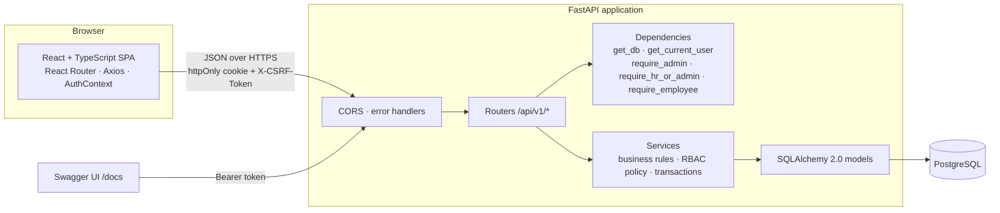
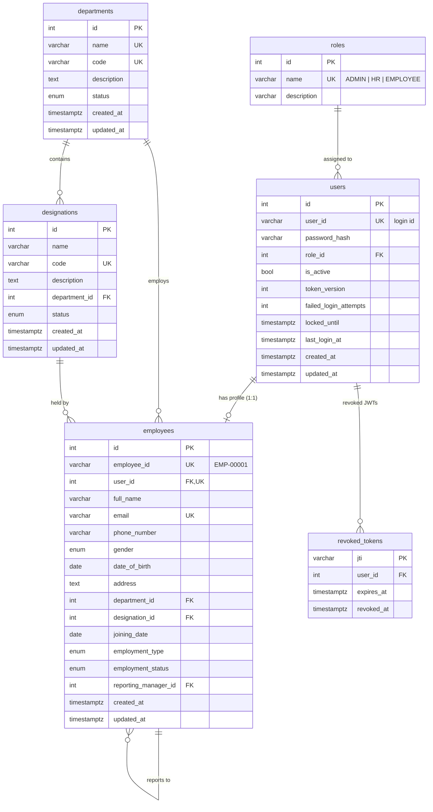

# HRMS — Architecture & Implementation Plan

This document covers execution steps 1–5 of the specification: the requirement analysis,
system architecture, ER diagram, folder structures, API surface and the phase plan.

---

## 1. Requirement analysis (summary)

| Area | Key decisions |
|---|---|
| Backend | FastAPI (sync endpoints run in the threadpool), Pydantic v2, SQLAlchemy 2.0 (typed `Mapped[]` declarative models), Alembic, psycopg 3 driver |
| Database | PostgreSQL 16. HR data is strongly relational (FKs, uniqueness, transactions), so PostgreSQL is preferred over MongoDB |
| Auth | Argon2id password hashing, HS256 JWT with `sub`, `role`, `jti`, `ver`, `iat`, `exp` claims |
| Token transport | **httpOnly cookie** for the browser (+ double-submit CSRF token); `Authorization: Bearer` accepted for Swagger / API clients |
| Logout | Server-side revocation: the token `jti` is written to `revoked_tokens`; `users.token_version` bump revokes *all* tokens (password change, deactivation) |
| RBAC | 3 roles stored in the `roles` table: `ADMIN`, `HR`, `EMPLOYEE`. Enforced only in the backend through `Depends()` dependencies and service-level policy checks |
| Ownership | Employee self-service endpoints resolve the record from the authenticated user's DB id (`employees.user_id == current_user.id`), never from a client-supplied ID |
| Employee ID | `EMP-00001` style, generated from a PostgreSQL `SEQUENCE` (`employee_code_seq`) — concurrency safe, never client supplied |
| Deletion | Employees are soft-deactivated (`employment_status`). Departments/designations can only be deleted when no employees are assigned; a reassign endpoint moves employees first |
| Future phases | Router registry + `employees.id` as the anchor FK for attendance, leave, payroll and performance tables |

## 2. System architecture



Request lifecycle for a protected endpoint:

1. `get_db` opens a session (rolled back on any exception, always closed).
2. `get_token_payload` reads the Bearer header or the `hrms_access_token` cookie, verifies signature + `exp`,
   and for cookie-authenticated unsafe methods checks the `X-CSRF-Token` header against the `hrms_csrf` cookie.
3. `get_current_user` loads the user, rejects revoked `jti`, stale `token_version`, inactive or locked accounts.
4. A role dependency (`require_admin`, `require_hr_or_admin`, `require_employee`) authorises the route.
5. The service applies fine-grained policy (e.g. HR may not touch ADMIN accounts) and commits the transaction.
6. The router serialises the result through a Pydantic response model (never raw ORM objects).

## 3. ER diagram



Constraints and indexes:

* `users.user_id`, `employees.employee_id`, `employees.email`, `employees.user_id`, `departments.name`,
  `departments.code`, `designations.code` — unique.
* `designations (department_id, name)` — unique (same title can exist in two departments).
* Indexes on every FK, `employees.full_name`, `employees.employment_status`, `revoked_tokens.expires_at`.
* `employees.department_id` / `designation_id` use `ON DELETE RESTRICT` — the DB itself blocks deleting an
  assigned department/designation, the service returns a friendly 409 before that.
* `employees.reporting_manager_id` uses `ON DELETE SET NULL`; the service rejects self-reference and cycles.
* `employees.user_id` uses `ON DELETE RESTRICT`; `designations.department_id` uses `ON DELETE CASCADE`
  (only reachable once the department has no employees).
* `employee_code_seq` — PostgreSQL sequence backing the Employee ID generator.

## 4. Folder structure

```
hrms/
├── docker-compose.yml
├── README.md · SETUP.md
├── docs/ARCHITECTURE.md
├── backend/
│   ├── Dockerfile · requirements.txt · .env.example · pytest.ini · alembic.ini
│   ├── alembic/ (env.py, versions/0001_initial_schema.py)
│   ├── app/
│   │   ├── main.py                 # app factory, CORS, router registration
│   │   ├── core/                   # config.py, security.py, exceptions.py, roles.py
│   │   ├── database/               # base.py (DeclarativeBase + mixins), session.py
│   │   ├── models/                 # role, user, employee, department, designation, token
│   │   ├── schemas/                # auth, user, employee, role, department, designation, dashboard, common
│   │   ├── routers/                # auth, users, roles, employees, departments, designations, dashboard
│   │   ├── services/               # *_service.py — all business logic
│   │   ├── dependencies/           # database.py, authentication.py, authorization.py
│   │   ├── utils/                  # employee_id.py, pagination.py
│   │   └── scripts/                # bootstrap_admin.py, seed_demo.py
│   └── tests/                      # conftest.py + test_auth / test_authorization / test_employees / ...
└── frontend/
    ├── Dockerfile · nginx.conf · package.json · vite.config.ts · tsconfig.json · .env.example
    └── src/
        ├── api/                    # client.ts (axios + CSRF), auth/employees/users/departments/... services
        ├── auth/                   # AuthContext.tsx, ProtectedRoute.tsx
        ├── components/             # Layout, Sidebar, Topbar, DataTable, Modal, ConfirmDialog, Toast, StatCard, ...
        ├── pages/                  # 12 pages
        ├── types/                  # shared TS types mirroring the Pydantic schemas
        └── styles/                 # global.css (design tokens)
```

## 5. API surface (`/api/v1`)

| Method | Path | Access | Notes |
|---|---|---|---|
| POST | `/auth/login` | public | sets httpOnly cookie + CSRF cookie, also returns token JSON |
| GET | `/auth/me` | authenticated | user, role, linked employee summary |
| POST | `/auth/logout` | authenticated | revokes `jti`, clears cookies — 204 |
| POST | `/auth/change-password` | authenticated | verifies current password, bumps `token_version` — 204 |
| GET | `/roles` | HR, Admin | |
| GET | `/users` | HR (EMPLOYEE accounts only), Admin | paginated, search, role filter |
| POST | `/users` | HR (EMPLOYEE role only), Admin | |
| GET | `/users/{id}` | HR (EMPLOYEE accounts), Admin | |
| PATCH | `/users/{id}` | HR (EMPLOYEE accounts), Admin | rename login id |
| PATCH | `/users/{id}/role` | Admin | cannot demote self / last admin |
| PATCH | `/users/{id}/status` | HR (EMPLOYEE accounts), Admin | activate / deactivate |
| POST | `/users/{id}/reset-password` | HR (EMPLOYEE accounts), Admin | revokes all tokens of target |
| GET | `/employees` | HR, Admin | page, page_size, search, department_id, designation_id, employment_status, employment_type, sort_by, sort_order |
| POST | `/employees` | HR, Admin | creates user account + profile in one transaction |
| GET | `/employees/me` | any user with a profile | ownership via JWT identity |
| PATCH | `/employees/me` | any user with a profile | only `phone_number`, `address` |
| GET | `/employees/{employee_id}` | HR, Admin; Employee only for own record | |
| PUT | `/employees/{employee_id}` | HR, Admin | full update; HR cannot edit ADMIN-linked profiles |
| PATCH | `/employees/{employee_id}/status` | HR, Admin | soft deactivate / reactivate; syncs `users.is_active` |
| GET | `/departments` | HR, Admin | with employee & designation counts |
| POST/PUT | `/departments`, `/departments/{id}` | Admin | |
| POST | `/departments/{id}/reassign-employees` | Admin | move employees before delete |
| DELETE | `/departments/{id}` | Admin | 409 while employees assigned |
| GET | `/designations` | HR, Admin | filter by department |
| POST/PUT | `/designations`, `/designations/{id}` | Admin | |
| POST | `/designations/{id}/reassign-employees` | Admin | |
| DELETE | `/designations/{id}` | Admin | 409 while employees assigned |
| GET | `/dashboard/admin` | Admin | |
| GET | `/dashboard/hr` | HR, Admin | |
| GET | `/dashboard/me` | any user with a profile | |
| GET | `/health` | public | DB connectivity check |

Error envelope for every non-2xx response:

```json
{ "error": { "code": "FORBIDDEN", "message": "Human readable message", "details": null } }
```

## 6. Phase plan

| Phase | Scope | Status in initial delivery |
|---|---|---|
| 1 Authentication & JWT | login / me / logout / change-password, Argon2, JWT, cookie + bearer, revocation, lockout | Implemented + tested |
| 2 RBAC | roles table, dependencies, service policy, privilege-escalation guards | Implemented + tested |
| 3 Employee management | CRUD-less-delete, search/filter/sort/paginate, soft deactivation, self-service | Implemented + tested |
| 4 Departments & designations | CRUD, status, reassign-then-delete | Implemented + tested |
| 5 Attendance | `attendance_records(employee_id FK → employees.id, date, check_in, check_out, status)` | Architecture only |
| 6 Leave | `leave_types`, `leave_balances`, `leave_requests (approver_id FK → employees.id)` | Architecture only |
| 7 Payroll | `salary_structures`, `payroll_runs`, `payslips` | Architecture only |
| 8 Performance | `review_cycles`, `goals`, `performance_reviews` | Architecture only |

### How phases 5–8 plug in without refactoring

1. Add `models/<module>.py` with FKs to `employees.id`; import it in `models/__init__.py` so Alembic autogenerate sees it.
2. `alembic revision --autogenerate -m "<module>"` → new migration on top of `0001`.
3. Add `schemas/<module>.py`, `services/<module>_service.py`, `routers/<module>.py`.
4. Register the router in `app/routers/__init__.py` (`API_ROUTERS` list) — `main.py` does not change.
5. Reuse the existing dependencies: `require_employee` for self-service (check-in, apply leave, view payslip),
   `require_hr_or_admin` for approvals/reports, `reporting_manager_id` for manager approval chains.
6. Add a sidebar entry in `frontend/src/components/navigation.ts` with the roles that may see it.
